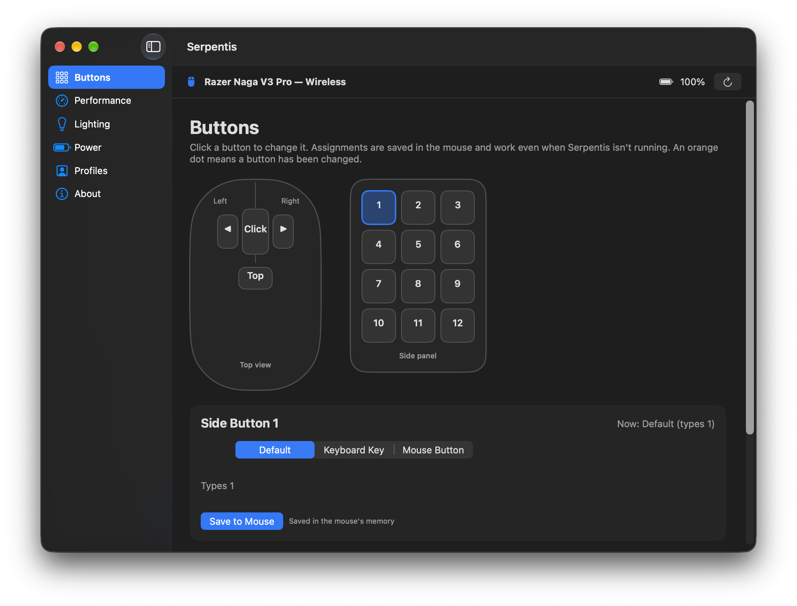

# Serpentis

**Control your Razer Naga V3 Pro on macOS — no Razer Synapse needed.**

Razer's Mac software doesn't support the Naga V3 Pro. Serpentis is a small, free, open-source Mac app that talks to the mouse directly, so you get your buttons, DPI, lighting and battery back on your Mac.

> Unofficial. Not affiliated with, authorized or endorsed by Razer Inc. Razer and Naga are trademarks of Razer Inc., used here only to identify compatible hardware.

<!-- Screenshots: add docs/screenshot-buttons.png etc. and uncomment

-->

## Features

- **Button remapping saved in the mouse** — all 12 side buttons plus wheel click, wheel tilt left/right and the button behind the wheel. Assign any key or key combination (⇧ ⌃ ⌥ ⌘) or a mouse button. Because it's stored in the mouse's own memory, it works even when Serpentis isn't running, and in any game.
- **Layouts** — save and load sets of button assignments, with optional automatic switching when World of Warcraft is in front.
- **DPI** — edit up to 5 DPI steps (what the DPI button cycles through), or set a custom DPI with separate X and Y.
- **Polling rate** — 125 / 500 / 1000 Hz.
- **Lighting** — scroll wheel, logo and side panel: color cycle, solid color, breathing or off, with brightness.
- **Battery** — level in the menu bar, charging indicator, low-battery notification.
- **Power** — sleep timer and low-power mode threshold.
- **Profiles** — save and switch DPI / polling / lighting setups.
- Works over the **USB cable** and the **wireless receiver**. Menu-bar icon for quick changes, plus a full settings window.

## Supported hardware

| Mouse | Status |
|---|---|
| Razer Naga V3 Pro (cable, USB ID 1532:00E7) | ✅ Tested |
| Razer Naga V3 Pro (wireless receiver, 1532:00E8) | ✅ Tested |
| Razer Naga V3 Pro over Bluetooth | ❓ Not tested |
| Other Naga models | ❓ Not yet — see *Help wanted* below |

Tested on macOS 27 with an Apple-silicon MacBook Air, mouse firmware 1.01, 12-button side plate.

## Install (about 5 minutes)

Serpentis is built on your own Mac from this source code. That keeps it free and means nothing is downloaded that you can't inspect.

1. **Download** — go to [github.com/darkside-dave/Serpentis](https://github.com/darkside-dave/Serpentis), click the green **Code** button → **Download ZIP**, and unzip it (double-click the file in Downloads).
2. **Quit Razer software** — if you've installed Razer Synapse for Mac, quit or uninstall it so the two don't fight over the mouse.
3. **Run the installer** — open the unzipped folder and double-click **Install Serpentis.command**.
   - macOS will say it can't verify the file. Click **Done**, then open **System Settings → Privacy & Security**, scroll down, and click **Open Anyway** next to "Install Serpentis.command". Confirm, and it runs.
   - If you don't have Apple's free developer tools yet, the installer opens a window to install them (about 1 GB). When that finishes, double-click the installer again.
4. **Done** — Serpentis appears in your Applications folder and opens automatically. If macOS asks to allow **Input Monitoring** or **notifications**, click Allow.

To update later, download the new ZIP and run the installer again — your settings are kept.

## Using it

- Click the **mouse icon in the menu bar** for quick changes, or choose **Open Serpentis…** for the full window.
- **Buttons page:** click a button on the drawing, pick *Default*, *Keyboard Key* or *Mouse Button*, then **Save to Mouse**. An orange dot marks changed buttons.
- Turn on **Start at Login** in the menu-bar menu so the battery display is always there.

## Uninstall

Double-click **Uninstall Serpentis.command**. To put the mouse's buttons back to factory settings first, use **Buttons → Reset All Buttons to Default**.

## FAQ

**Is it safe for my mouse?** Serpentis only sends the same kinds of settings messages Razer Synapse sends. It never touches the mouse's firmware. Every change is checked against the mouse's reply, and *Reset All* restores the factory button layout.

**Does it work with WoW / other games?** Yes. Button assignments live in the mouse, so games see normal key presses. Keep it one press = one action; Serpentis has no macros.

**Websites say my polling rate is only 60–120 Hz.** That's normal on a Mac — browsers bundle mouse events to the screen refresh rate. Serpentis reads the real rate from the mouse.

**Firmware updates?** Not possible from a Mac. Use Razer Synapse on a Windows PC for those.

## Help wanted

- **Owners of other Naga models** (V2 Pro, V2 HyperSpeed, Naga X, Left-Handed, Trinity…): open an issue — supporting a new model usually just takes a few read-only tests on your mouse.
- Bug reports: open an issue and include `app/build-log.txt` if the build failed.

How it works is documented in [docs/PROTOCOL.md](docs/PROTOCOL.md).

## Support the project

Serpentis is free. If it saved you some frustration, you can [buy me a coffee on Ko-fi](https://ko-fi.com/darkside_dave) ☕

## License

MIT — see [LICENSE](LICENSE).
