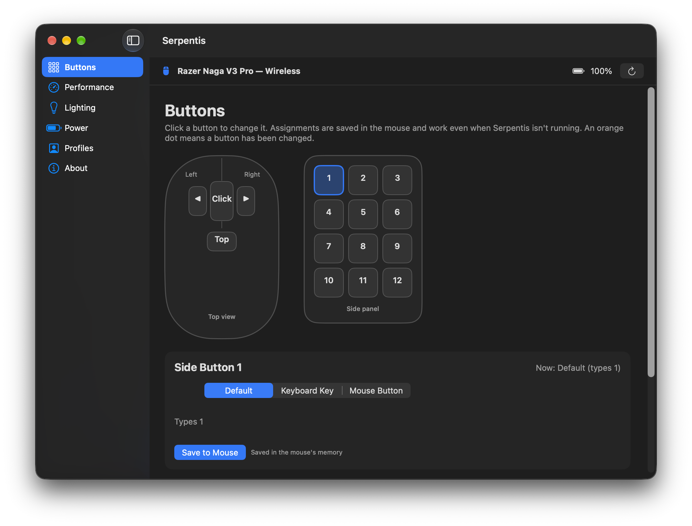

# Serpentis

**Control your Razer Naga V3 Pro on macOS — no Razer Synapse needed.**

Razer's Mac software doesn't support the Naga V3 Pro. Serpentis is a small, free, open-source Mac app that talks to the mouse directly, so you get your buttons, DPI, lighting and battery back on your Mac.

> Unofficial. Not affiliated with, authorized or endorsed by Razer Inc. Razer and Naga are trademarks of Razer Inc., used here only to identify compatible hardware.

<!-- Screenshots: add docs/screenshot-buttons.png etc. and uncomment

-->

## Features

- **Button remapping saved in the mouse** — all 12 side buttons plus wheel click, wheel tilt left/right and the button behind the wheel. Assign any key or key combination (⇧ ⌃ ⌥ ⌘) or a mouse button. Because it's stored in the mouse's own memory, it works even when Serpentis isn't running, and in any game.
- **Optional physical keyboard modifiers** — combine a mouse keyboard assignment with held Ctrl, Shift, Option and Command keys. This opt-in software filter requires Serpentis to stay open and has not yet been validated with live hardware input.
- **Per-mouse vertical scrolling** — optionally choose Standard or Natural for the identified mouse without changing the trackpad, other devices or the global macOS setting. Requires Serpentis to stay open; live input validation is still required.
- **Layouts** — save and load sets of button assignments, with optional automatic switching when World of Warcraft is in front.
- **DPI** — edit up to 5 DPI steps (what the DPI button cycles through), or set a custom DPI with separate X and Y.
- **Polling rate** — 125 / 500 / 1000 Hz.
- **Lighting** — scroll wheel, logo and side panel: color cycle, solid color, breathing or off, with brightness.
- **Battery** — level in the menu bar, charging indicator, low-battery notification.
- **Power** — sleep timer and low-power mode threshold.
- **Profiles** — save and switch DPI / polling / lighting setups.
- Works over the **USB cable** and the **wireless receiver**. Menu-bar icon for quick changes, plus a full settings window.

## Supported hardware

| Mouse | Status |
|---|---|
| Razer Naga V3 Pro (cable, USB ID 1532:00E7) | ✅ Tested |
| Razer Naga V3 Pro (wireless receiver, 1532:00E8) | ✅ Tested |
| Razer Naga V3 Pro over Bluetooth | ❓ Not tested |
| Other Naga models | ❓ Not yet — see *Help wanted* below |

Tested on macOS 27 with an Apple-silicon MacBook Air, mouse firmware 1.01, 12-button side plate.

The hardware results above describe the original settings functionality, **not**
the new physical-modifier or scrolling filters. Their live cable/receiver behavior
remains unverified. Bluetooth is not supported by their USB device identification.

## Install (about 5 minutes)

Serpentis is built on your own Mac from this source code. That keeps it free and means nothing is downloaded that you can't inspect.

1. **Download** — go to [github.com/darkside-dave/Serpentis](https://github.com/darkside-dave/Serpentis), click the green **Code** button → **Download ZIP**, and unzip it (double-click the file in Downloads).
2. **Quit Razer software** — if you've installed Razer Synapse for Mac, quit or uninstall it so the two don't fight over the mouse.
3. **Run the installer** — open the unzipped folder and double-click **Install Serpentis.command**.
   - macOS will say it can't verify the file. Click **Done**, then open **System Settings → Privacy & Security**, scroll down, and click **Open Anyway** next to "Install Serpentis.command". Confirm, and it runs.
   - If you don't have Apple's free developer tools yet, the installer opens a window to install them (about 1 GB). When that finishes, double-click the installer again.
4. **Done** — Serpentis appears in your Applications folder and opens automatically. If macOS asks to allow **Input Monitoring** or **notifications**, click Allow.

To update later, download the new ZIP and run the installer again — your settings are kept.

## Using it

- Click the **mouse icon in the menu bar** for quick changes, or choose **Open Serpentis…** for the full window.
- **Buttons page:** click a button on the drawing, pick *Default*, *Keyboard Key* or *Mouse Button*, then **Save to Mouse**. An orange dot marks changed buttons.
- Turn on **Start at Login** in the menu-bar menu so the battery display is always there.

### Combining mouse keys with physical keyboard modifiers

1. On **Buttons**, select a remappable button and **Keyboard Key**.
2. Capture the key, then select **Combine with physical keyboard modifiers**.
3. Use **Grant Permissions…** and allow Serpentis in **System Settings → Privacy &
   Security → Input Monitoring** and **Accessibility**.
4. Choose **Save and Enable Filter**. Keep Serpentis open. After changing macOS
   permissions, relaunch it if necessary and use **Retry Filter**.

An assignment to `1` combines with whichever of Ctrl, Shift, Option and Command
are physically held. Changes while the button is held apply to subsequent
hardware repeats and release events. Left/right modifier keys and multiple
physical keyboards are tracked independently. Explicit assignment modifiers are
**united** with physical modifiers: fixed Ctrl plus physical Shift produces
Ctrl+Shift, not a replacement of Ctrl.

The option is off for all existing assignments and layouts. Fixed shortcuts and
mouse actions keep their hardware behavior. The new options are stored separately
on this Mac and saved/restored with layouts; the original layout and DPI/lighting
profile JSON formats are unchanged. Loading an old layout turns the option off.
DPI/lighting profiles do not contain button assignments and do not change this
option.

The filter changes flags on the mouse's existing keyboard events; it does not
reinject keys, create repeats, or synthesize modifier presses/releases. It leaves
physical keyboard events, including the same key code, untouched. Disabling it,
changing layouts, disconnecting the mouse, quitting, or an interception failure
does not create key-up events. When filtering stops, the underlying hardware
assignment still works with its recorded modifiers; dynamic combination is no
longer guaranteed.

**Buttons and limits**

- The same option is available for all exposed keyboard assignments: side buttons,
  right click, wheel click, both wheel tilts and the top button. The primary left
  click remains locked. A rejected hardware write is an error, not confirmation of
  support.
- Additional known hardware IDs are queried read-only and displayed only if they
  return an assignment. Discovery alone does **not** prove a usable physical
  button event. Their restore action uses the assignment captured when the mouse
  connected, not an unknown factory default.
- A button that produces no identifiable keyboard event cannot use this filter.
  Wheel tilts may produce pulses: the filter preserves those down/up events and
  does not invent a held action.
- If several buttons emit the same key, their origin cannot be distinguished in
  the mouse's keyboard reports. They must use the same option and fixed modifiers.
  Use the explicit **Apply the modifier option to all buttons emitting this key**
  checkbox to change them together, or choose distinct keys. Otherwise saving is
  rejected without changing the existing assignments.
- Rollover, repeat generation and release ordering remain controlled by the
  firmware. In particular, independent holds of identical hardware outputs cannot
  be reconstructed from merged reports. The filter does not claim to repair
  firmware limitations.

**Identification and privacy**

Mouse keyboard interfaces are identified within the selected USB device's registry
subtree. This requires dynamically resolved system symbols,
`CGEventCopyIOHIDEvent` and `IOHIDEventGetSenderID`; these are not stable public
CoreGraphics API contracts. Missing identity, permissions or an interrupted tap
disables filtering and reports an error. There is no global-keyboard interception
fallback.

Quartz flags and its global key-state query cannot distinguish a physical
keyboard modifier from the mouse's configured modifier reports at initialization.
The filter therefore uses public IOKit APIs restricted to the eight left/right
modifier elements of keyboard devices, excluding supported mouse interfaces. This
also seeds modifiers already held at activation and excludes synthetic
CoreGraphics input. No ordinary keyboard values or typed text are read or logged.
Input callbacks run on a separate run loop, without hardware settings commands or
UI work.

### Choosing this mouse's scroll direction

On **Performance → Mouse Scrolling**, enable **Customize vertical scrolling for
this mouse**, then choose **Standard** (traditional wheel direction) or **Natural**
(content follows the wheel movement). The choice takes effect without a hardware
settings refresh and is restored when the same identified mouse reconnects or
Serpentis restarts.

- Only the **vertical axis** changes. Horizontal scrolling, wheel-tilt assignments,
  pointer movement, clicks and keyboard shortcuts retain their existing behavior.
  Custom tilt actions are still handled by the mouse firmware, not converted
  into scroll events by this filter.
- This is a **per-mouse preference, independent of layouts and profiles**. It is
  off by default, including for existing installations. Turning it off restores
  macOS behavior for that mouse; it does not pause other features. There is no
  additional global pause mode.
- Use **Grant Permissions...** to allow Serpentis in **Input Monitoring** and
  **Accessibility**, then **Retry**. Relaunch after permission changes if required.
  Keep the app running: this option is a software filter, not mouse firmware.
  Missing permissions, identification failures and interrupted interception are
  reported rather than shown as working. An interrupted tap stops; Retry or a
  foreground refresh can reapply the saved choice.
- The stored choice is the desired direction, not a permanent inversion flag.
  Serpentis reads `com.apple.swipescrolldirection` and computes
  `shouldInvert = systemNatural != desiredNatural`. If macOS has no explicit
  value, its default is treated as Natural; invalid values/read failures stop
  custom scrolling with an error. Serpentis **never writes this system setting**.
  It rereads before applying configuration, on foreground activation and on
  preference notifications. A two-second read-only poll covers missing system
  notifications; an external system change may take up to that interval to apply.
- Only identified events from the selected USB mouse are eligible. Trackpads,
  other mice, unknown origins and synthetic events pass through unchanged. A
  modifiable session event tap updates the original event, after the system's
  scrolling transformation, without posting replacement events. Line, pixel and
  exact fixed-point vertical deltas are read together and then inverted; other
  event properties and the horizontal/third axes are preserved.

The preference key uses a local hash of the mouse's firmware serial number, not
its model, USB port or temporary registry ID. No serial is logged or transmitted.
If a usable serial cannot be read, per-mouse settings are unavailable rather
than shared across all mice. Whether cable and receiver firmware expose the
same serial still needs hardware verification; different reported serials are
treated as different identities.

**Identification and distribution limits:** the scrolling filter deliberately
reuses the existing USB-subtree identification and dynamically loaded
`CGEventCopyIOHIDEvent` / `IOHIDEventGetSenderID` symbols. These are non-public
contracts, not a stable macOS device-identification API. USB interfaces sharing
an indistinguishable sender cannot be separated by this approach; Bluetooth and
shared receivers without distinct device origins are not claimed as supported.
There is no "all wheel events are this mouse" fallback. Do not treat this as an
App Store-compatible implementation: it is intended for the current locally
built, non-sandboxed app, and future macOS changes may disable it.

## Uninstall

Double-click **Uninstall Serpentis.command**. To put the mouse's buttons back to factory settings first, use **Buttons → Reset All Buttons to Default**.

## FAQ

**Is it safe for my mouse?** Serpentis only sends the same kinds of settings messages Razer Synapse sends. It never touches the mouse's firmware. Every change is checked against the mouse's reply, and *Reset All* restores the factory button layout.

**Does it work with WoW / other games?** Yes. Button assignments live in the mouse, so games see normal key presses. Keep it one press = one action; Serpentis has no macros.

**Websites say my polling rate is only 60–120 Hz.** That's normal on a Mac — browsers bundle mouse events to the screen refresh rate. Serpentis reads the real rate from the mouse.

**Firmware updates?** Not possible from a Mac. Use Razer Synapse on a Windows PC for those.

## Help wanted

- **Owners of other Naga models** (V2 Pro, V2 HyperSpeed, Naga X, Left-Handed, Trinity…): open an issue — supporting a new model usually just takes a few read-only tests on your mouse.
- Bug reports: open an issue and include `app/build-log.txt` if the build failed.

How it works is documented in [docs/PROTOCOL.md](docs/PROTOCOL.md).

## Development and tests

The installer compiles the application directly with `swiftc`; it does not use
Swift Package Manager. Run the characterization tests from the repository root:

```sh
bash app/Tests/run.sh
```

The [CI workflow](.github/workflows/ci.yml) runs the same tests on a hosted macOS
runner for every push and pull request, including feature-branch bases. It also builds the
optimized application with a macOS 13 deployment target. No connected mouse,
input permissions or signing credentials are required. Passing CI does not
replace the live hardware checks described below.

The tests use only Apple's Command Line Tools, without XCTest, a full Xcode
installation, or third-party dependencies. They compile the application sources
without its launch entry point and run an isolated test executable. HID commands
and delays use an injected transport, keyboard capture is called with unposted
events, and persistence uses temporary, uniquely named defaults domains that are
removed after each test. No mouse is required, no hardware settings are changed,
and no keystrokes are sent to the user session.

Coverage includes hardware assignment reads and writes, fixed shortcuts, factory
restoration, reply verification and bounded retries, default detection, legacy
layout/profile persistence, opt-in persistence, device routing, modifier
combinations and left/right state, simultaneous keys, unposted repeat/release
events, synthetic/physical-keyboard isolation, core filter shutdown, legacy layout
switching and rejected-write rollback.

Scrolling tests cover all four system/desired combinations, signed/zero and
fractional deltas, metadata/axis preservation on unposted native events,
other-device/unknown/synthetic isolation, horizontal tilt and keyboard remaps,
per-mouse persistence, hot preference changes, foreground/system refresh order,
permission/interruption errors, stale completions, disconnect/shutdown and
reconnection. The shared input run-loop worker is tested without an input tap.

These are deterministic tests of decisions and event transformations, not live
event-tap or firmware certification. Before considering hardware support validated,
manually check cable and receiver operation, event sender identification, initial
held modifiers, changes during holds/repeats, identical outputs and simultaneous
physical keyboard keys, tilt pulses, permission revocation, secure-input/tap
interruptions, layout changes, unplug/reconnect and application shutdown. No live
hardware input validation has been performed for this filter.

For custom scrolling, remaining hardware checks include all four direction
combinations on cable and receiver, simultaneous trackpad/second-mouse input,
actual event sender IDs at the session tap, serial identity across transports,
horizontal tilt actions, system-setting changes while backgrounded, permission
revocation/tap interruptions, reconnect and quitting. Automated tests do not
confirm live device filtering or cable/receiver compatibility.

## Support the project

Serpentis is free. If it saved you some frustration, you can [buy me a coffee on Ko-fi](https://ko-fi.com/darkside_dave) ☕

## License

MIT — see [LICENSE](LICENSE).
